# Introduction to gridmicrotex

## Quick start

[`grid.latex()`](https://adayim.github.io/gridmicrotex/reference/latex_grob.md)
draws LaTeX on the current page;
[`latex_grob()`](https://adayim.github.io/gridmicrotex/reference/latex_grob.md)
returns it as a grob.

``` r

library(gridmicrotex)
library(grid)

grid.newpage()
grid.latex(r"($\frac{\textcolor{red}{-b} \pm \sqrt{b^2 - 4ac}}{2a}$)")
```

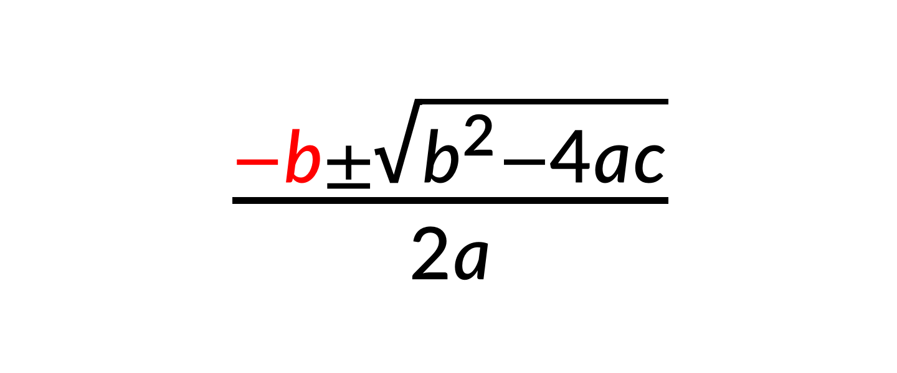

Write LaTeX in a raw string, `r"(...)"`, so backslashes need no
doubling.

## Text and math

A string is read like a line of LaTeX text: math goes between `$...$` or
`\(...\)`, and a newline starts a new line. With `input_mode = "math"`
the whole string is math and text goes in `\text{}`. These two are the
same:

``` r

grid.newpage()
grid.latex(r"(Famous: $E = mc^2$)",
           x = 0.05, y = 0.7, hjust = 0)
grid.latex(r"(\text{Famous: } E = mc^2)", input_mode = "math",
           x = 0.05, y = 0.3, hjust = 0)
```


`input_mode = "document"` reads a document body with paragraphs,
headings and displayed equations (see
[`vignette("documents")`](https://adayim.github.io/gridmicrotex/articles/documents.md)).
`latex_options(input_mode = )` sets the default for the session.

Mistakes do not stop the drawing. One warning lists each problem with
its line and column, and an unknown command is drawn in red:

``` r

grid.newpage()
grid.latex(r"(Area $\pi r^2$, see \nosuchcommand{here})")
#> Warning: LaTeX input: 1:21: unknown command \nosuchcommand: drawn as its name
```


## Base graphics

Set `latex_options(device_math = TRUE)` and write `$...$` in any base
plot label:

``` r

latex_options(device_math = TRUE)

plot(1:10, (1:10)^2,
     main = r"(Slope $\hat{\beta}_1 = \sum_{i=1}^{n} x_i^2$)",
     xlab = r"($x$)", ylab = r"($\frac{y}{2}$)")
text(3, 80, r"($\int_0^\infty e^{-x^2}\,dx$)", col = "steelblue")
```

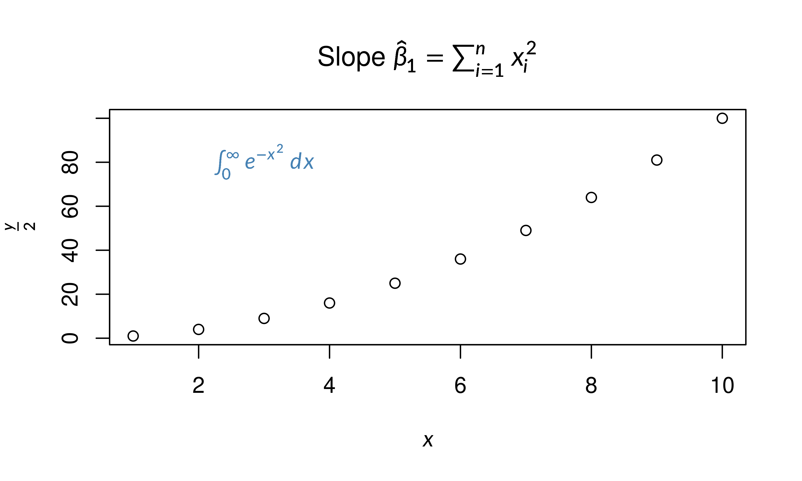

See
[`vignette("base-graphics")`](https://adayim.github.io/gridmicrotex/articles/base-graphics.md)
for details.

## Examples

Assorted notation: `split` alignment, fraktur, stacked delimiters,
`\sideset`, extensible arrows, `\rotatebox` and `\reflectbox`:

``` r

grid.newpage()
grid.latex(r"(
\definecolor{gris}{gray}{0.9}
\definecolor{noir}{rgb}{0,0,0}
\fatalIfCmdConflict{false}
\newcommand{\pa}{\left|}
\begin{array}{c}
  \LaTeX\\
  \begin{split}
      |I_2| &= \pa\int_0^T\psi(t)\left\{ u(a,t)-\int_{\gamma(t)}^a \frac{d\theta}{k} (\theta,t) \int_a^\theta c(\xi)
          u_t (\xi,t)\,d\xi\right\}dt\right|\\
      &\le C_6 \Bigg|\pa f \int_\Omega \pa\widetilde{S}^{-1,0}_{a,-}
          W_2(\Omega, \Gamma_1)\right|\ \right|\left| |u|\overset{\circ}{\to} W_2^{\widetilde{A}}(\Omega\Gamma_r,T)\right|\Bigg|\\
      &\\
      &\begin{pmatrix}
          \alpha&\beta&\gamma&\delta\\
          \aleph&\beth&\gimel&\daleth\\
          \mathfrak{A}&\mathfrak{B}&\mathfrak{C}&\mathfrak{D}\\
          \boldsymbol{\mathfrak{a}}&\boldsymbol{\mathfrak{b}}&\boldsymbol{\mathfrak{c}}&\boldsymbol{\mathfrak{d}}
      \end{pmatrix}
      \quad{(a+b)}^{\frac{n}{2}}=\sqrt{\sum_{k=0}^n\tbinom{n}{k}a^kb^{n-k}}\quad
          \Biggl(\biggl(\Bigl(\bigl(()\bigr)\Bigr)\biggr)\Biggr)\\
      &\forall\varepsilon\in\mathbb{R}_+^*\ \exists\eta>0\ |x-x_0|\leq\eta\Longrightarrow|f(x)-f(x_0)|\leq\varepsilon\\
      &\det
      \begin{bmatrix}
          a_{11}&a_{12}&\cdots&a_{1n}\\
          a_{21}&\ddots&&\vdots\\
          \vdots&&\ddots&\vdots\\
          a_{n1}&\cdots&\cdots&a_{nn}
      \end{bmatrix}
      \overset{\mathrm{def}}{=}\sum_{\sigma\in\mathfrak{S}_n}\varepsilon(\sigma)\prod_{k=1}^n a_{k\sigma(k)}\\
      &\Delta f(x,y)=\frac{\partial^2f}{\partial x^2}+\frac{\partial^2f}{\partial y^2}\qquad\qquad \fcolorbox{noir}{gris}
          {n!\underset{n\rightarrow+\infty}{\sim} {\left(\frac{n}{e}\right)}^n\sqrt{2\pi n}}\\
      &\sideset{_\alpha^\beta}{_\gamma^\delta}{
      \begin{pmatrix}
          a&b\\
          c&d
      \end{pmatrix}}
      \xrightarrow[T]{n\pm i-j}\sideset{^t}{}A\xleftarrow{\overrightarrow{u}\wedge\overrightarrow{v}}
          \underleftrightarrow{\iint_{\mathds{R}^2}e^{-\left(x^2+y^2\right)}\,\mathrm{d}x\mathrm{d}y}
  \end{split}\\
  \rotatebox{30}{\sum_{n=1}^{+\infty}}\quad\mbox{Mirror rorriM}\reflectbox{\mbox{Mirror rorriM}}
\end{array}
)", render_mode = "path")
```

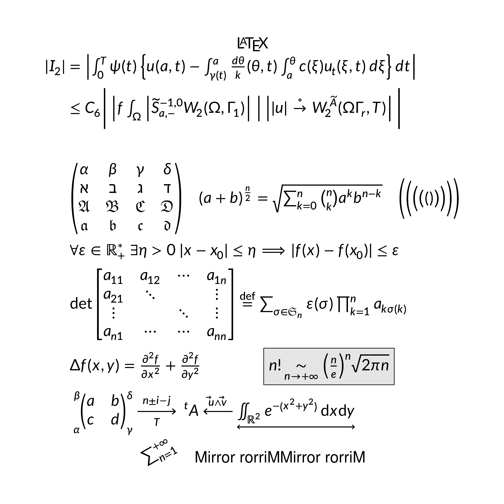

## Placing a formula

`hjust` and `vjust` take numbers or names. `vjust = "baseline"` puts the
formula’s baseline on `y`, so it lines up with text beside it:

``` r

grid.newpage()
y <- 0.5
grid.segments(unit(0, "npc"), unit(y, "npc"),
              unit(1, "npc"), unit(y, "npc"), gp = gpar(col = "grey80"))
grid.text("if ", x = 0.10, y = y, just = c(0, 0.5), gp = gpar(fontsize = 20))
grid.latex(r"($x \geq \sqrt{2\pi}$)",
           x = 0.22, y = y, hjust = "left", vjust = "baseline",
           gp = gpar(fontsize = 20))
grid.text(", then proceed.", x = 0.62, y = y, just = c(0, 0.5),
          gp = gpar(fontsize = 20))
```

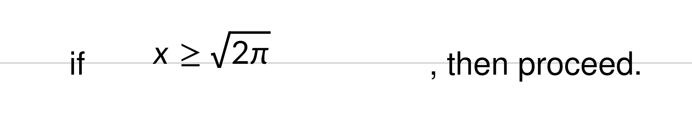

### Named anchors

`\mark{name}` records a point inside a formula, and
[`grobMark()`](https://adayim.github.io/gridmicrotex/reference/grobMark.md)
returns it as grid units, ready for an arrow or a callout:

``` r

g <- latex_grob(r"($a^2 + b\mark{term}^2 \mark{equals}= c^2$)",
                x = 0.5, y = 0.4)
grid.newpage()
grid.draw(g)

mk_eq <- grobMark(g, "equals")
grid.segments(mk_eq$x, mk_eq$y + unit(15, "mm"),
              mk_eq$x, mk_eq$y + unit(3, "mm"),
              arrow = arrow(length = unit(2, "mm"), type = "closed"),
              gp = gpar(col = "red"))
grid.text("equals", x = mk_eq$x, y = mk_eq$y + unit(18, "mm"),
          gp = gpar(col = "red"))

mk_bsq <- grobMark(g, "term")
grid.segments(mk_bsq$x - unit(6, "mm"), mk_bsq$y - unit(15, "mm"),
              mk_bsq$x - unit(2, "mm"), mk_bsq$y - unit(3, "mm"),
              arrow = arrow(length = unit(2, "mm"), type = "closed"),
              gp = gpar(col = "blue"))
grid.text("b² term", x = mk_bsq$x - unit(7, "mm"),
          y = mk_bsq$y - unit(18, "mm"), just = "right",
          gp = gpar(col = "blue"))
```

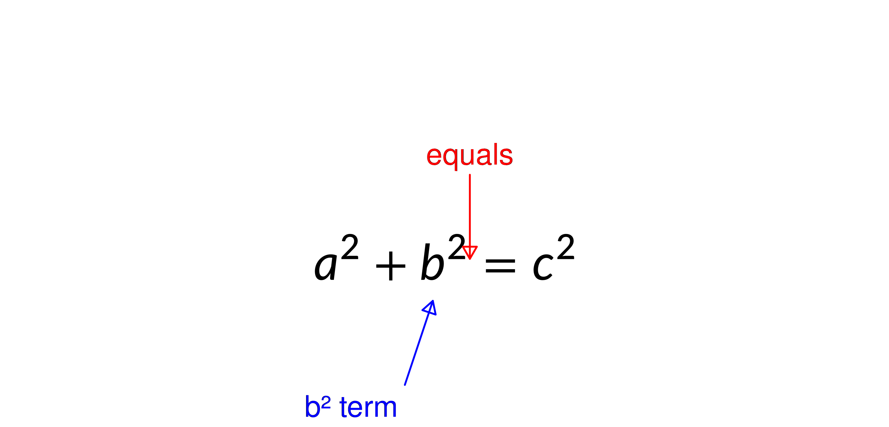

## Display and text style

`$...$` sets a formula in text style, as in a paragraph; `$$...$$` sets
it in display style, with limits above and below. A label without
delimiters is set in text style. `tex_style` overrides this:

``` r

sum_expr <- r"(\sum_{i=1}^{n} \frac{x_i}{n})"
styles <- c("display", "text", "script", "scriptscript")
labels <- c('"display"  ($$...$$)', '"text"  ($...$)',
            '"script"', '"scriptscript"')

grid.newpage()
for (i in seq_along(styles)) {
  pushViewport(viewport(x = (i - 0.5) / 4, width = 1 / 4))
  grid.text(labels[i], y = 0.88, gp = gpar(cex = 0.75, fontface = "bold"))
  grid.latex(sum_expr, y = 0.42, input_mode = "math",
             tex_style = styles[i], gp = gpar(fontsize = 20))
  grid.rect(gp = gpar(col = "grey85", fill = NA))
  popViewport()
}
```

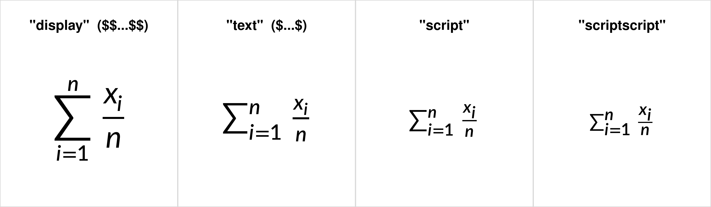

All four use the same font size. To change the style of part of a
formula, use `\displaystyle`, `\textstyle`, `\scriptstyle` or
`\scriptscriptstyle`.

## Line wrapping

`max_width`, in big points, wraps a label over several lines.
`justify = TRUE` fills every line but the last, and
`line_break = "optimal"` balances the breaks across the paragraph:

``` r

prose <- paste(rep(
  r"(The quick brown fox jumps over the lazy dog, and $x^2$ too.)", 3),
  collapse = " ")

grid.newpage()
pushViewport(viewport(layout = grid.layout(2, 1)))
pushViewport(viewport(layout.pos.row = 1))
grid.text("ragged (default)", x = 0.02, y = 0.98, hjust = 0, vjust = 1,
          gp = gpar(col = "grey40"))
grid.latex(prose, x = 0.02, y = 0.78, hjust = 0, vjust = 1,
           max_width = 3.6 * 72, gp = gpar(fontsize = 11))
popViewport()
pushViewport(viewport(layout.pos.row = 2))
grid.text("justified + optimal", x = 0.02, y = 0.98, hjust = 0, vjust = 1,
          gp = gpar(col = "grey40"))
grid.latex(prose, x = 0.02, y = 0.78, hjust = 0, vjust = 1,
           max_width = 3.6 * 72, justify = TRUE, line_break = "optimal",
           gp = gpar(fontsize = 11))
popViewport(2)
```

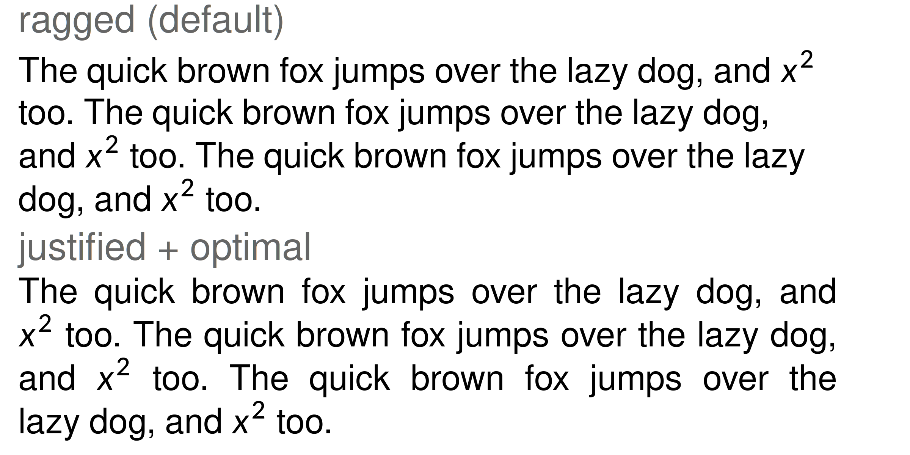

Words are not hyphenated. Mark where one may break with `\-`, as in
`in\-ter\-na\-tion\-al`.

## Images

`\includegraphics` draws a PNG, JPEG or SVG file. Size it with `width`,
`height` or `scale`, and rotate it with `angle`. The extension may be
left off, and `\graphicspath{{figs/}}` adds a folder to search.

``` r

fig <- tempfile(fileext = ".svg")
svglite::svglite(fig, width = 2, height = 1.2)
grid.newpage()
grid.circle(r = 0.35, gp = gpar(fill = "steelblue", col = NA))
dev.off()
#> png 
#>   2

grid.newpage()
grid.latex(sprintf(r"(before \includegraphics[width=1in]{%s} after)", fig),
           gp = gpar(fontsize = 20))
```

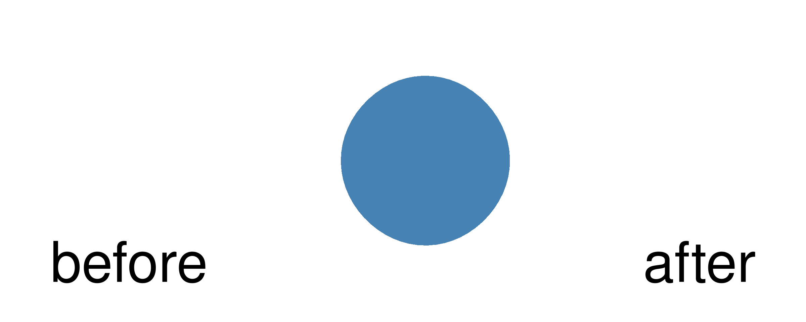

An inline image sits on the baseline; `\raisebox` moves it. A `\caption`
is drawn where it is written. To centre a figure and its caption, put
them in a one-column `array`:

``` r

logo <- system.file("img", "Rlogo.png", package = "png")
grid.newpage()
grid.latex(sprintf(r"(\begin{array}{c}
  \includegraphics[width=0.6in]{%s}\\
  \caption{Figure 1: the R logo}
\end{array})", logo), gp = gpar(fontsize = 11))
```

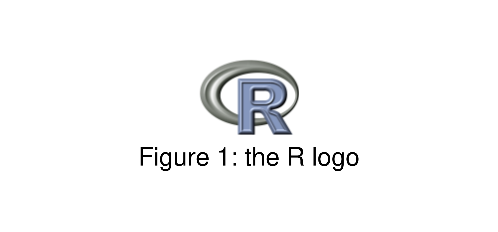

Prefer SVG, which stays sharp at any size. A PNG or JPEG warns when it
is shown below 150 dpi. PDF and EPS files are not supported.

## Fonts

Two math fonts are included:

| Alias              | Font           | Style      | Pairs with             |
|--------------------|----------------|------------|------------------------|
| `"lete"` (default) | Lete Sans Math | Sans-serif | `fontfamily = "sans"`  |
| `"stix"`           | STIX Two Math  | Serif      | `fontfamily = "serif"` |

Choose one with `math_font`, or for the session with
`latex_options(math_font = )`. Text follows `gp$fontfamily`:

``` r

formula <- r"(Theorem: $\int_0^1 f(x)\,dx \geq 0$)"

grid.newpage()
pushViewport(viewport(layout = grid.layout(2, 1)))
pushViewport(viewport(layout.pos.row = 1))
grid.latex(formula, gp = gpar(fontfamily = "sans"))
upViewport()
pushViewport(viewport(layout.pos.row = 2))
grid.latex(formula, math_font = "stix",
           gp = gpar(fontfamily = "serif"))
upViewport(2)
```


Any font R can use works for text, including CJK and right-to-left
scripts:

``` r

grid.newpage()
grid.latex(r"(如果 $x > 0$ 则 $y = x^2$)", y = unit(0.7, "npc"),
           gp = gpar(fontfamily = "sans"))
grid.latex(r"($E = mc^2$ معادلة أينشتاين)", y = unit(0.3, "npc"),
           gp = gpar(fontfamily = "sans"))
```

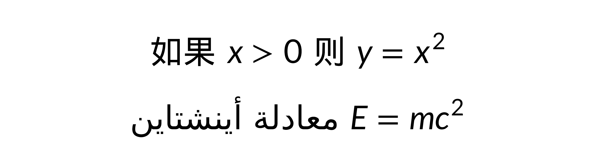

`\textsf{}` and `\texttt{}` set text in the sans and mono fonts, and
`\textrm{}` returns to `gp$fontfamily`:

``` r

grid.newpage()
grid.latex(
  r"(\textsf{sans \textrm{body} sans} \quad \texttt{mono})",
  gp = gpar(fontfamily = "serif")
)
```

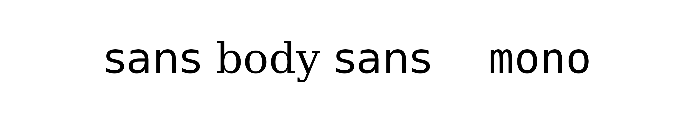

### Your own fonts

[`load_font()`](https://adayim.github.io/gridmicrotex/reference/load_font.md)
names a font file, or an installed family, once, and loads an OpenType
math font for `math_font` the same way. The name then works wherever a
font is named: in `gp`, in
[`latex_options()`](https://adayim.github.io/gridmicrotex/reference/latex_options.md)
(`main_font`, `sans_font`, `mono_font`) and in the LaTeX itself, with
the commands of fontspec and unicode-math (`\setmainfont`,
`\setsansfont`, `\setmonofont`, `\setmathfont`, `\fontspec`,
`\newfontfamily`) and `\fontfamily{...}\selectfont`, which also reads
LaTeX’s family codes such as `ppl` for Palatino.

``` r

# A font file of your own, here the bundled Lete Sans Math
otf <- system.file("fonts", "LeteSansMath.otf", package = "gridmicrotex")
load_font(otf, name = "My Font", bold = otf)

grid.newpage()
grid.latex(r"(\setmainfont{My Font} body, \textbf{bold} and
          {\fontspec{STIX Two Math} another font})")
```


Text in a loaded font is drawn from its file on every device,
[`pdf()`](https://rdrr.io/r/grDevices/pdf.html) included. `bold` and
`italic` are the files of those faces, so `\textbf` and `\textit` use
the real design.
[`available_fonts()`](https://adayim.github.io/gridmicrotex/reference/available_fonts.md)
lists what is loaded.

An installed family is loaded by its name; its bold and italic faces are
found on their own. The families installed differ from one system to the
next, so this chunk is not run:

``` r

unique(systemfonts::system_fonts()$family)   # what is installed

load_font("Georgia")                          # registered as "Georgia"
latex_options(main_font = "Georgia")
grid.latex(r"(Text in \textbf{Georgia} and $x^2$)")
```

## Devices

By default glyphs are drawn as text, so PDF and SVG output can be
selected and searched. This needs `ragg`, `svglite` or
[`cairo_pdf()`](https://rdrr.io/r/grDevices/cairo.html); on other
devices, such as [`pdf()`](https://rdrr.io/r/grDevices/pdf.html), glyphs
are drawn as outlines with a warning. `render_mode = "path"` always
draws outlines: it works on every device, but the text cannot be
selected.

If the default device on Windows or macOS warns `font family not found`,
use [`ragg::agg_png()`](https://ragg.r-lib.org/reference/agg_png.html)
instead.

`showtext::showtext_auto()` turns all text into outlines, formulas
included. Turn it off with `showtext::showtext_auto(FALSE)`.

## Utilities

[`latex_dims()`](https://adayim.github.io/gridmicrotex/reference/latex_dims.md)
measures a formula:

``` r

latex_dims(r"(\frac{a}{b})", gp = gpar(fontsize = 20))
#> $width
#> [1] 12bigpts
#> 
#> $height
#> [1] 25bigpts
#> 
#> $depth
#> [1] 9bigpts
#> 
#> $baseline
#> [1] 9.35305953025818bigpts
#> 
#> $is_split
#> [1] FALSE
```

[`latex_options()`](https://adayim.github.io/gridmicrotex/reference/latex_options.md)
sets defaults for the session; arguments given in a call always win:

``` r

latex_options(math_font = "stix")
latex_options()        # show the current settings
reset_latex_options()  # back to the defaults
```

[`define_macro()`](https://adayim.github.io/gridmicrotex/reference/define_macro.md)
adds a shorthand for every later label:

``` r

define_macro("RR", r"(\mathbb{R})")
define_macro("eps", r"(\varepsilon)")

grid.newpage()
grid.latex(r"($\forall \eps > 0, \eps \in \RR$)")
```


``` r


clear_macros()
```

A label can also define its own, with `\newcommand` or `\def`. These
last for that label only:

``` r

grid.newpage()
grid.latex(
  r"(\def\norm#1{\left\lVert #1 \right\rVert}
      $\norm{\vec{v}} = \sqrt{\langle \vec{v}, \vec{v} \rangle}$)"
)
```


`debug = TRUE` draws the bounding box and baseline:

``` r

grid.newpage()
grid.latex(r"($x^{2} + y_{i}$)", debug = TRUE)
```


## Diagrams

`tikzpicture` draws paths, nodes and arrows as TikZ does, with the
`positioning`, `arrows.meta`, `calc` and `fit` libraries, shapes
(`rectangle`, `circle`, `ellipse`, `diamond`, `rounded rectangle`,
`regular polygon`, `star`), `label` and `pin`, `\foreach`, `plot`,
`\clip` to a convex region, trees (`child`), `matrix of nodes` and
`brace` decorations:

``` r

flow <- r"(\begin{tikzpicture}[node distance = 9mm, >=stealth,
    box/.style = {draw, rounded corners, minimum width = 18mm, minimum height = 7mm}]
  \node[box] (read) {Read data};
  \node[draw, diamond, aspect = 2, right = of read] (clean) {Clean?};
  \node[box, fill = blue!10, right = of clean] (fit) {Fit};
  \node[box, fill = green!15, below = 12mm of fit, label = left:{$\hat\beta$}] (out) {Estimates};
  \node[draw, dashed, rounded corners, inner sep = 3mm, fit = (clean) (fit),
        label = above:model] {};
  \draw[->] (read) -- (clean);
  \draw[->] (clean) -- node[above] {yes} (fit);
  \draw[->] (clean) |- ++(0, -1.2) node[right] {no} -| (read);
  \draw[->] (fit) -- (out);
  \foreach \i in {1, 2, 3}
    \fill[gray] ($(out.east) + (\i * 3mm, 0)$) circle (1pt);
\end{tikzpicture})"
grid.newpage()
grid.latex(flow, gp = gpar(fontsize = 11))
```

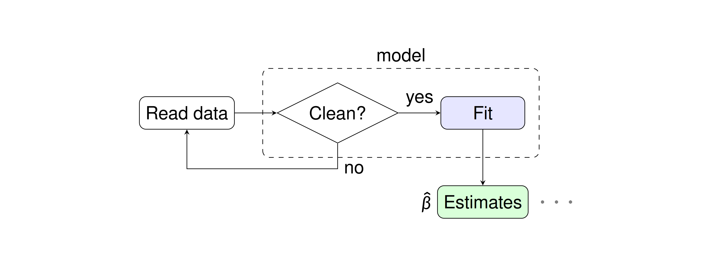

tikz-cd’s `tikzcd` and amscd’s `CD` draw commutative diagrams: objects
in a grid joined by arrows. In `tikzcd` an arrow is written in the cell
it leaves, with the direction it goes (`r`, `d`, `dr`, `rr`, …), a label
in quotes (a prime puts it on the other side), and a style. Styles
include `hook`, `tail`, `two heads`, `mapsto`, `dashed`, `dotted`,
`Rightarrow`, `equal`, `harpoon`, `squiggly`, `bend left`,
`shift right`, `crossing over`, `phantom` and a colour name; labels take
`description`, `near start` and `near end`; and `row sep` and
`column sep` set the spacing. `CD` writes its arrows between the objects
instead. From left to right: a square with a dashed diagonal, two bent
arrows, and the square again in `CD`:

``` r

sq <- r"(\begin{tikzcd}
A \arrow[r, "f"] \arrow[d, "g"'] \arrow[dr, dashed] & B \arrow[d, "h"] \\
C \arrow[r, hook, "k"'] & D
\end{tikzcd})"
bent <- r"(\begin{tikzcd}[column sep=large]
A \arrow[r, "f", bend left] \arrow[r, "g"', bend right]
  & B \arrow[r, two heads, mapsto] & C
\end{tikzcd})"
cd <- r"(\begin{CD}
A @>f>> B \\
@VgVV @VVhV \\
C @>>k> D
\end{CD})"
grid.newpage()
grid.latex(sq,   x = 0.14, gp = gpar(fontsize = 14))
grid.latex(bent, x = 0.50, gp = gpar(fontsize = 14))
grid.latex(cd,   x = 0.87, gp = gpar(fontsize = 14))
```


## Pasting LaTeX

Tables from `knitr::kable(format = "latex")`, kableExtra, `xtable`, gt
and tinytable can be pasted unchanged. A table is set to the `max_width`
it is given, so a full-width kableExtra or gt table is drawn as it is:

``` r

tab <- knitr::kable(head(mtcars[, 1:4], 3), format = "latex",
                    booktabs = TRUE, digits = 1)
grid.newpage()
grid.latex(as.character(tab), input_mode = "document", max_width = 4 * 72,
           x = 0.05, y = 0.95, hjust = 0, vjust = 1, gp = gpar(fontsize = 11))
```


## What is supported

A list of what is drawn, each with its LaTeX source and the package’s
output, is on the package website as `supported-functions.pdf`.
`source(system.file( "supported/build.R", package = "gridmicrotex"))`
and `build_supported()` write it, and its LaTeX file, wherever you ask.

## Not supported

- Pages: `\pageref` draws `??`.
- Automatic hyphenation, and the parts of TikZ that are not listed under
  Diagrams (other shapes, `let`, shading, most decorations). Anything a
  picture leaves out is drawn without it, with a warning.
- `\usepackage` loads only the packages that come with gridmicrotex and
  files you give to
  [`load_sty()`](https://adayim.github.io/gridmicrotex/reference/load_sty.md);
  a package from a TeX installation is not read.
- A formula between two right-to-left words is not reordered.
